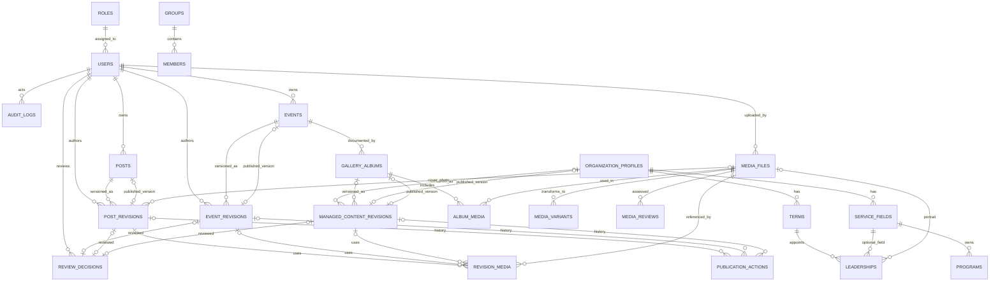

# ERD & Kamus Data — Prototype Website Angkatan Muda Airlow

**Versi:** 1.1 (penyelarasan rancangan, belum diterapkan)  
**Tanggal:** 24 Oktober 2026  
**Teknologi sasaran:** Laravel + Livewire + Blade + Tailwind CSS + MySQL 8.x  
**Sumber kebutuhan:** PRD Prototype Website Angkatan Muda Airlow v1.1, Design System v1.1, Wireframe v1.1, keputusan perencanaan kelompok.  
**Lingkup:** Data simulasi. Tidak memuat data pribadi anggota yang sebenarnya.

## 1. Tujuan dan prinsip rancangan

Rancangan ini mendukung situs publik, dashboard dua peran (Admin/Pengurus), daftar anggota privat, profil organisasi, program dan kepengurusan, kegiatan/kalender, berita/pengumuman, foto dan galeri, serta moderasi terverifikasi sebelum publikasi. Fitur ditandai **[MVP]** atau **[Lanjutan]**.

**Konvensi teknis:** Semua tabel memiliki `id BIGINT UNSIGNED PRIMARY KEY AUTO_INCREMENT`; pivot memakai surrogate id dengan unique gabungan yang disebutkan. `created_at` dan `updated_at` berjenis `TIMESTAMP NULL`, kecuali review_decisions/media_reviews/publication_actions append-only yang memakai waktu kejadian eksplisit, serta audit_logs yang hanya created_at. Foreign key umumnya `BIGINT UNSIGNED`. Gunakan `utf8mb4`, InnoDB, dan indeks eksplisit. Waktu disimpan UTC dan ditampilkan WIT (Asia/Jayapura untuk demo; dapat dikonfigurasi). `deleted_at TIMESTAMP NULL` hanya untuk tabel soft delete. Hindari cascade delete pada catatan persetujuan, publikasi, dan audit. Ini rancangan database aplikasi; tabel infrastruktur Laravel/Fortify tetap dipertahankan dan tidak digandakan.

**Penandaan:** `PK` = primary key; `FK` = foreign key; `UQ` = unique; `NN` = NOT NULL; `?` = nullable. Atribut standar `id`, `created_at`, `updated_at` dianggap ada dan tidak diulang di setiap definisi.

## 2. Diagram ERD inti

Diagram berikut menekankan hubungan operasional (bukan seluruh kolom). Untuk menjaga keterbacaan, detail kolom ada dalam kamus data.

**Catatan notasi:** Satu parent memiliki maksimal satu versi publik aktif, satu revisi maksimal dipilih parent pemiliknya; relasi versioned_as tetap 1:N. `published_revision_id` menunjuk revisi **milik item yang sama**; cek parent lewat transaksi/constraint gabungan, bukan FK id saja. Hubungan alternatif pada diagram bersifat XOR: satu managed_content_revision milik organisasi ATAU album; satu review_decision/revision_media/publication_action menunjuk revisi post ATAU event ATAU managed. Bukan tiga target sekaligus. FK published_revision_id ditambahkan setelah tabel revisi terbentuk untuk menghindari urutan FK sirkuler. Relasi penanggung jawab, penerbit, dan foto tambahan dijelaskan dalam kamus data walau tidak seluruhnya digambar.

### 2.1 Kamus status bersama
| Lingkup | Nilai | Label UI |
|---|---|---|
| Revisi | `draft` | Draft |
| Revisi | `pending_review` | Menunggu persetujuan |
| Revisi | `revision_requested` | Perlu revisi |
| Revisi | `approved` | Disetujui |
| Revisi | `rejected` | Ditolak |
| Publikasi | `unpublished` | Belum terbit |
| Publikasi | `published` | Terbit |
| Publikasi | `archived` | Arsip |

Revisi yang pernah diterbitkan tetapi bukan versi aktif diberi keterangan **Versi terdahulu** atau **Diarsipkan** sesuai riwayat; jangan menyebutnya belum diterbitkan. Keterangan ini bukan status revisi baru.

workflow_status adalah status revisi; publication_status adalah status parent. Keduanya tidak saling menggantikan. Bantuan untuk revisi approved yang belum pernah diterbitkan: **Disetujui — belum diterbitkan**. Moderasi media memakai `pending_review`, `approved`, `rejected`; keterbitan media diturunkan dari referensi publikasi aktif. Status anggota/program/impor tetap domain tersendiri.

## 3. Kamus data — tabel MVP

### A. Identitas dan hak akses

**1. `roles` [MVP]** — `code VARCHAR(30) NN UQ` (`admin`, `pengurus`), `name VARCHAR(80) NN`, `description TEXT ?`. Dua baris peran awal; penambahan peran hanya lewat revisi kebutuhan.

**2. `users` [MVP]** — `role_id FK roles NN`, `name VARCHAR(120) NN`, `email VARCHAR(190) NN UQ`, `password VARCHAR(255) NN` (hash, tidak pernah plaintext), `is_active BOOLEAN NN DEFAULT TRUE`, `email_verified_at TIMESTAMP ?`, `remember_token VARCHAR(100) ?`, `last_login_at TIMESTAMP ?`. Tidak ada pendaftaran publik. Penghapusan pengguna dinonaktifkan secara fisik apabila ada jejak penulis/reviewer; gunakan `is_active=false`. Akun tidak otomatis terhubung dengan baris anggota (`members`).

**3. `groups` [MVP]** — `name VARCHAR(120) NN UQ`, `code VARCHAR(30) NN UQ`, `description TEXT ?`, `is_active BOOLEAN NN DEFAULT TRUE`. Nama kelompok merupakan data simulasi.

**4. `members` [MVP]** — `group_id FK groups NN`, `member_code VARCHAR(40) NN UQ`, `full_name VARCHAR(150) NN`, `gender VARCHAR(20) ?` (pilihan nilai dibatasi di aplikasi), `joined_on DATE ?`, `status VARCHAR(20) NN DEFAULT 'aktif'` (misal aktif, nonaktif), `internal_note TEXT ?`, `deleted_at TIMESTAMP ?` (soft delete). **Pengurus hanya menerima `full_name`, `groups.name`, `status` dalam response**. `member_code`, gender, tanggal bergabung, dan catatan internal tidak diserialisasi kepada Pengurus; tidak ada endpoint publik.

### B. Profil organisasi

**5. `organization_profiles` [MVP]** — `display_name VARCHAR(190) NN`, `short_description TEXT ?`, `history LONGTEXT ?`, `vision TEXT ?`, `mission LONGTEXT ?`, `contact_email VARCHAR(190) ?`, `contact_phone VARCHAR(40) ?`, `contact_address TEXT ?`, `logo_media_id FK media_files ?`, `updated_by FK users ?`, `is_demo BOOLEAN NN DEFAULT TRUE`. Prototype cukup **satu record organisasi**, divalidasi pada service/admin; jika kelak multi-organisasi ditambahkan, relasi harus direvisi secara eksplisit.

**6. `service_fields` [MVP]** — `organization_profile_id FK organization_profiles NN`, `name VARCHAR(120) NN`, `description TEXT ?`, `sort_order INT UNSIGNED NN DEFAULT 0`, `is_active BOOLEAN NN DEFAULT TRUE`; `UQ(organization_profile_id, name)`.

**7. `terms` [MVP]** — `organization_profile_id FK organization_profiles NN`, `label VARCHAR(90) NN`, `starts_on DATE NN`, `ends_on DATE NN`, `is_current BOOLEAN NN DEFAULT FALSE`; CHECK `ends_on >= starts_on`, UQ `(organization_profile_id,label)`; hanya satu masa bakti aktif per organisasi ditegakkan transaksi aplikasi atau indeks/generated column sesuai MySQL. Overlap masa bakti perlu aturan organisasi, tidak diasumsikan otomatis dilarang.

**8. `leaderships` [MVP]** — `term_id FK terms NN`, `service_field_id FK service_fields ?`, `person_name VARCHAR(150) NN` (nama fiktif), `position_title VARCHAR(120) NN`, `photo_media_id FK media_files ?`, `sort_order INT UNSIGNED NN DEFAULT 0`, `is_public BOOLEAN NN DEFAULT TRUE`. is_public hanya pilihan penyertaan pada snapshot organisasi, bukan izin akses langsung ke tabel kerja. Kepengurusan dan users terpisah; pembatasan duplikat jabatan tergantung aturan organisasi.

**9. `programs` [MVP]** — `service_field_id FK service_fields ?`, `term_id FK terms ?`, `title VARCHAR(190) NN`, `description TEXT ?`, `start_on DATE ?`, `end_on DATE ?`, `status VARCHAR(20) NN DEFAULT 'direncanakan'`, `sort_order INT UNSIGNED NN DEFAULT 0`; CHECK akhir >= awal ketika kedua tanggal diisi. Editor konten profil/program hanya Admin pada MVP untuk memenuhi kontrol persetujuan sederhana.

**Pelengkap B:** organization_profiles juga memiliki `created_by FK users NN`, `publication_status VARCHAR(20) NN DEFAULT 'unpublished'`, `published_revision_id FK managed_content_revisions ?` (UNIQUE), `published_at TIMESTAMP ?`, `published_by FK users ?`. programs memiliki `slug VARCHAR(190) NN UQ`. Tabel B adalah data kerja privat; seluruh halaman Tentang/Pengurus/Program Kerja/Kontak membaca snapshot paket organisasi yang diterbitkan, bukan baris kerja terbaru. Paket hanya satu organisasi dan menyertakan profil, bidang, masa bakti, kepengurusan yang dipilih, program (id + slug stabil), kontak, serta referensi media. Admin menyimpan revisi paket, mengajukan, menyetujui, kemudian menerbitkan melalui aksi terpisah. Tidak diperlukan peran/editor tambahan untuk modul ini.

### C. Agenda dan publikasi yang memiliki revisi

**10. `events` [MVP]** — Identitas stabil kegiatan: `slug VARCHAR(190) NN UQ`, `created_by FK users NN` (pembuat awal, immutable), `owner_id FK users NN`, `assigned_editor_id FK users ?`, `publication_status VARCHAR(20) NN DEFAULT 'unpublished'`, `published_revision_id FK event_revisions ?` (UNIQUE), `published_at TIMESTAMP ?`, `published_by FK users ?`, `deleted_at TIMESTAMP ?`. Publik membaca hanya revisi yang dipilih dan publication_status published; draft terbaru tetap privat.

**11. `event_revisions` [MVP]** — `event_id FK events NN`, `version_no INT UNSIGNED NN`, `author_id FK users NN`, `submitted_by FK users ?`, `title VARCHAR(190) NN`, `category VARCHAR(50) NN`, `description LONGTEXT ?`, `starts_at DATETIME NN`, `ends_at DATETIME ?`, `venue VARCHAR(190) ?`, `location_note TEXT ?`, `cover_media_id FK media_files ?`, `workflow_status VARCHAR(20) NN DEFAULT 'draft'`, `submitted_at TIMESTAMP ?`; `UQ(event_id, version_no)`, CHECK `ends_at IS NULL OR ends_at >= starts_at`. Isi revisi dan lampiran dibekukan setelah draft diajukan; transisi status resmi masih diizinkan. Gunakan kamus §2.1.

**12. `posts` [MVP]** — Identitas berita/pengumuman: `type VARCHAR(20) NN` (`news` atau `announcement`), `slug VARCHAR(190) NN UQ` bersama kedua tipe, `created_by FK users NN` (immutable), `owner_id FK users NN`, `assigned_editor_id FK users ?`, `publication_status VARCHAR(20) NN DEFAULT 'unpublished'`, `published_revision_id FK post_revisions ?` (UNIQUE), `published_at TIMESTAMP ?`, `published_by FK users ?`, `deleted_at TIMESTAMP ?`. Type dan slug tetap setelah penerbitan pertama.

**13. `post_revisions` [MVP]** — `post_id FK posts NN`, `version_no INT UNSIGNED NN`, `author_id FK users NN`, `submitted_by FK users ?`, `title VARCHAR(190) NN`, `excerpt TEXT ?`, `body LONGTEXT NN`, `cover_media_id FK media_files ?`, `is_important BOOLEAN NN DEFAULT FALSE`, `workflow_status VARCHAR(20) NN DEFAULT 'draft'`, `submitted_at TIMESTAMP ?`; `UQ(post_id,version_no)`. is_important hanya berlaku untuk announcement dan menentukan penonjolan di beranda; tetap bagian revisi yang direview. Sanitasi rich text saat render; tautan media dalam isi harus terdaftar di revision_media, bukan URL privat mentah. Ringkasan dan cover opsional; isi/lampiran dibekukan setelah diajukan.

**14. `review_decisions` [MVP]** — Jejak keputusan **append-only**: `post_revision_id FK post_revisions ?`, `event_revision_id FK event_revisions ?`, `managed_revision_id FK managed_content_revisions ?`, `reviewer_id FK users NN`, `decision VARCHAR(20) NN` (`approved`, `revision_requested`, `rejected`), `reason TEXT ?`, `decided_at TIMESTAMP NN`; CHECK **tepat satu** FK revisi terisi. UNIQUE terpisah pada setiap FK revisi nullable memastikan maksimal satu keputusan final per versi; null target lain boleh berulang. Alasan nonkosong wajib untuk revision_requested/rejected. Reviewer Admin aktif diverifikasi server; pengajuan ulang membutuhkan draft versi baru. Index `(reviewer_id,decided_at)`.

**Aturan publikasi kritis — dua operasi terpisah:**
1. **Setujui:** transaksi memeriksa Admin aktif dan revisi pending_review, mengunci parent/revisi, mencatat review_decision approved, lalu mengubah workflow_status menjadi approved. Tidak mengubah published_revision_id, publication_status, published_at, atau published_by.
2. **Terbitkan:** transaksi lain memeriksa Admin aktif, revisi approved dengan keputusan yang cocok, parent yang benar, serta seluruh media approved/siap. Kunci parent/revisi dengan urutan konsisten; periksa token versi parent yang dilihat pengguna untuk menolak operasi kedaluwarsa. Ganti penunjuk versi publik, set publication_status published, published_at waktu aktual UTC, published_by aktor, dan tambahkan publication_action dalam transaksi yang sama. Tidak ada publikasi otomatis atau terjadwal di MVP.
3. **Revisi ulang:** draft baru tidak mengubah penunjuk publik lama. Ini berlaku juga saat revisi pengganti sudah approved dan bagi revisi buatan Admin. Isi versi yang sudah diajukan tidak dapat ditimpa; perubahan menghasilkan nomor versi baru. Admin boleh menyetujui karya sendiri melalui aksi eksplisit; tidak diwajibkan reviewer kedua.
4. **Arsip/tarik-terbit:** Admin mengubah published menjadi archived, mencatat alasan dan publication_action; penunjuk terakhir dipertahankan hanya untuk histori, tidak memberi akses publik. Terbitkan kembali adalah operasi eksplisit dengan validasi ulang, waktu/aktor baru, dan riwayat baru. Ulang kirim operasi Terbitkan pada versi yang sudah aktif tidak menggandakan riwayat; operasi penggantian bersaing harus ditolak bila token parent tidak cocok.
5. **Cache dan file:** perubahan publikasi memicu invalidasi cache setelah commit. Bila kontrol akses file tidak dapat dijamin, tolak penerbitan; jangan menaruh file privat di public storage sebagai jalan pintas.

### D. Media dan galeri

**15. `media_files` [MVP]** — `uploaded_by FK users NN`, `disk VARCHAR(40) NN`, `path VARCHAR(500) NN UQ`, `original_name VARCHAR(255) NN`, `mime_type VARCHAR(100) NN`, `file_size_bytes BIGINT UNSIGNED NN`, `width INT UNSIGNED ?`, `height INT UNSIGNED ?`, `alt_text VARCHAR(255) ?`, `checksum_sha256 CHAR(64) ?`, `moderation_status VARCHAR(20) NN DEFAULT 'pending_review'` (`pending_review`, `approved`, `rejected`), `deleted_at TIMESTAMP ?`. Validasi MIME aktual, ukuran, dimensi, ekstensi dan file rusak. Semua file tetap pada disk privat, termasuk sesudah approved; endpoint menentukan akses. Approved hanya moderasi, bukan status publikasi. File yang direferensikan revisi beku tidak boleh ditimpa; penggantian memakai media id baru dan moderasi baru.

**16. `media_variants` [MVP]** — `media_file_id FK media_files NN`, `variant VARCHAR(40) NN` (`thumbnail`, `optimized`), `disk VARCHAR(40) NN`, `path VARCHAR(500) NN UQ`, `mime_type VARCHAR(100) NN`, `width INT UNSIGNED NN`, `height INT UNSIGNED NN`, `file_size_bytes BIGINT UNSIGNED NN`; `UQ(media_file_id,variant)`. Penghapusan file fisik memerlukan job pembersihan terkontrol, bukan FK saja.

**17. `gallery_albums` [MVP]** — `event_id FK events ?`, `slug VARCHAR(190) NN UQ`, `title VARCHAR(190) NN`, `description TEXT ?`, `cover_media_id FK media_files ?`, `created_by FK users NN`, `publication_status VARCHAR(20) NN DEFAULT 'unpublished'`, `published_revision_id FK managed_content_revisions ?` (UNIQUE), `published_at TIMESTAMP ?`, `published_by FK users ?`, `sort_order INT UNSIGNED NN DEFAULT 0`. Data kerja Admin-only; publik membaca snapshot album terbit. Keterkaitan event, sampul, caption, dan daftar foto dibekukan dalam snapshot, bukan dibaca dari draft terbaru. Album terkait event hanya publik jika event dalam snapshot masih published dan tidak dihapus. Sampul harus termasuk foto approved di snapshot; bila belum dipilih, gunakan foto approved pertama sesuai urutan snapshot. Simpan urutan dasar untuk stabilitas; UI pengurutan foto yang lebih kaya tetap lanjutan.

**18. `album_media` [MVP]** — `album_id FK gallery_albums NN`, `media_file_id FK media_files NN`, `sort_order INT UNSIGNED NN DEFAULT 0`, `caption VARCHAR(255) ?`; `UQ(album_id,media_file_id)`. Ini relasi kerja privat; versi publik memakai snapshot + revision_media. Pengurus mengunggah untuk review, tetapi hanya Admin mengelola versi album, menyetujui dan menerbitkannya. Satu foto dapat berada di beberapa album; tidak menambah pustaka media lengkap lintas konten dalam MVP.

**19. `media_reviews` [MVP]** — `media_file_id FK media_files NN`, `reviewer_id FK users NN`, `decision VARCHAR(20) NN` (`approved`, `rejected`), `reason TEXT ?`, `decided_at TIMESTAMP NN`. Riwayat append-only; `reason` wajib untuk penolakan. Jika foto yang diusulkan pengurus berada di berita/agenda, publikasi tetap membutuhkan review konten *dan* status persetujuan file. Admin dapat meninjau foto galeri tanpa membuat berita terpisah.

### D.1 Struktur pendukung versi dan publikasi [MVP]
Struktur ini melengkapi pengamanan fitur terpilih; bukan modul produk baru atau perluasan fitur lanjutan.

**19a. `managed_content_revisions`** — `organization_profile_id FK organization_profiles ?`, `album_id FK gallery_albums ?`, `version_no INT UNSIGNED NN`, `author_id FK users NN`, `submitted_by FK users ?`, `workflow_status VARCHAR(20) NN DEFAULT 'draft'`, `submitted_at TIMESTAMP ?`, `payload_json JSON NN`, `event_id FK events ?` (keterkaitan album yang dibekukan). CHECK tepat satu organization_profile_id/album_id; event_id hanya untuk revisi album. `UQ(organization_profile_id,version_no)` dan `UQ(album_id,version_no)`. Payload organisasi memuat snapshot profil/bidang/masa bakti/kepengurusan/program/kontak; payload album memuat judul/deskripsi/urutan/caption. Payload memakai skema tervalidasi dan data publik saja, bukan akun/anggota privat. Identitas program (id+slug) tetap berasal programs; snapshot memberi isi versi publik. Semua referensi media wajib ada di revision_media, bukan path storage dalam JSON. Isi/relasi beku setelah diajukan; hanya Admin boleh mengelola modul ini. Jika program/baris organisasi dihapus dari data kerja, snapshot historis tetap utuh; slug program tetap dicadangkan.

**19b. `revision_media`** — `post_revision_id FK post_revisions ?`, `event_revision_id FK event_revisions ?`, `managed_revision_id FK managed_content_revisions ?`, `media_file_id FK media_files NN`, `purpose VARCHAR(30) NN` (cover/inline/gallery/logo/portrait), `alt_text VARCHAR(255) ?`, `caption VARCHAR(255) ?`, `sort_order INT UNSIGNED NN DEFAULT 0`. CHECK tepat satu FK revisi; UNIQUE `(masing-masing FK revisi,media_file_id,purpose)`. Index media_file_id. Alt/caption/urutan adalah metadata snapshot yang tidak berubah saat metadata media kerja berubah. Semua cover_media_id dan foto pada JSON/isi harus cocok dengan baris ini. Alt bermakna wajib untuk gambar informatif; dekoratif memakai alt kosong secara sengaja. Relasi ini membuktikan pemakaian pada revisi publik aktif; FK RESTRICT menjaga referensi.

**19c. `publication_actions`** — append-only: `post_revision_id FK post_revisions ?`, `event_revision_id FK event_revisions ?`, `managed_revision_id FK managed_content_revisions ?`, `actor_id FK users NN`, `action VARCHAR(20) NN` (`published`, `archived`), `reason TEXT ?`, `occurred_at TIMESTAMP NN`. CHECK tepat satu target revisi; alasan wajib untuk archived. Index tiap target + occurred_at, `(actor_id,occurred_at)`. Satu revisi boleh memiliki beberapa aksi sah (terbit, arsip, terbit kembali); jangan UNIQUE target saja. Aktor/waktu persetujuan ada di review_decisions, aktor/waktu penerbitan ada di sini dan pada parent aktif. Terbit pertama = aksi published paling awal pada parent; pembaruan = publikasi pengganti, bukan waktu menyimpan draft. publication_actions merupakan riwayat bisnis minimum MVP; dashboard audit umum tetap lanjutan.

### E. Audit & konfigurasi sistem

**20. `audit_logs` [Lanjutan]** — `actor_id FK users ?` (RESTRICT untuk akun yang direferensikan; null hanya bagi aksi sistem), `action VARCHAR(100) NN`, `subject_type VARCHAR(80) NN`, `subject_id BIGINT UNSIGNED ?`, `description VARCHAR(255) ?`, `changes_json JSON ?`, `ip_address VARCHAR(45) ?`, `created_at TIMESTAMP NN`. Menonaktifkan akun tidak mengosongkan actor_id. Tidak menyimpan password, token sesi, isi catatan rahasia, atau file impor lengkap. Log append-only dan dibatasi Admin; gunakan indeks `(subject_type, subject_id)` dan `(actor_id,created_at)`.

### F. Impor anggota (lanjutan)

**21. `member_import_batches` [Lanjutan]** — `uploaded_by FK users NN`, `source_filename VARCHAR(255) NN`, `stored_file_path VARCHAR(500) ?`, `status VARCHAR(20) NN` (`uploaded`, `validated`, `processing`, `completed`, `failed`), `total_rows INT UNSIGNED NN DEFAULT 0`, `accepted_rows INT UNSIGNED NN DEFAULT 0`, `rejected_rows INT UNSIGNED NN DEFAULT 0`, `completed_at TIMESTAMP ?`. File asli harus privat dan memiliki batas retensi.

**22. `member_import_rows` [Lanjutan]** — `batch_id FK member_import_batches NN`, `row_number INT UNSIGNED NN`, `member_id FK members ?`, `status VARCHAR(20) NN`, `error_codes JSON ?`, `normalized_data JSON ?`; `UQ(batch_id,row_number)`. Jangan menyimpan biodata sensitif yang tidak diperlukan dalam `normalized_data`; hapus sesuai kebijakan retensi.

## 4. Relasi dan kardinalitas

| Relasi | Kardinalitas | Makna |
|---|---|---|
| `roles → users` | 1:N | Satu peran digunakan banyak akun |
| `groups → members` | 1:N | Setiap anggota berada di satu kelompok pada MVP |
| `organization_profiles → service_fields, terms` | 1:N | Satu organisasi memiliki bidang dan periode kepengurusan |
| `terms → leaderships` | 1:N | Satu masa bakti memiliki banyak posisi pengurus |
| `service_fields → programs` | 1:N opsional pada anak | Program dapat berafiliasi dengan bidang tertentu |
| `events → event_revisions` | 1:N | Riwayat revisi kegiatan |
| `posts → post_revisions` | 1:N | Riwayat revisi berita/pengumuman |
| `event_revisions/post_revisions/managed_content_revisions → review_decisions` | 1:0..1 per jenis revisi | XOR tiga target dan UNIQUE masing-masing FK |
| `organization_profiles/gallery_albums → managed_content_revisions` | 1:N per jenis parent | XOR dua parent; snapshot versi organisasi/album |
| `parent → published_revision_id` | 0..1 revisi terpilih | Revisi harus milik parent; hanya status published memberi akses |
| `revisions → revision_media → media_files` | N:M, satu jenis revisi per baris penghubung | Metadata tampilan beku; publik hanya dari revisi aktif |
| `revisions → publication_actions` | 1:N per jenis revisi | Histori terbit/arsip terpisah dari review |
| `events → gallery_albums` | 1:N opsional pada album | Album boleh terkait kegiatan tertentu |
| `gallery_albums ↔ media_files` | N:M lewat `album_media` | Satu foto bisa tampil di beberapa album |
| `media_files → media_variants` | 1:N | Satu file punya versi thumbnail dan optimized |
| `users → uploads/revisions/reviews` | 1:N | Jejak penanggung jawab |
| `users → audit_logs` | 1:N opsional pada log | Aktor dapat dipertahankan sebagai akun nonaktif |
| `member_import_batches → member_import_rows` | 1:N | Laporan validasi impor per baris |

**Catatan:** Tidak ada registrasi acara dan absensi dalam MVP. Modul `event_registrations`/`attendances` baru dirancang jika dipilih secara eksplisit pada pengembangan berikutnya, bukan diam-diam dianggap wajib.

## 5. Constraint, indeks, dan kebijakan penghapusan

1. **FK ketat:** `members.group_id → groups.id` RESTRICT; jangan hapus kelompok yang punya anggota. Untuk dokumen historis (`post/event revisions`, reviews) jangan lakukan cascade delete akun atau item induk.
2. **Unik:** users.email, roles.code, groups.code, members.member_code; slug pada events/posts/gallery_albums/programs; pasangan parent+version_no pada tiap revisi; FK target nullable review_decisions; published_revision_id pada masing-masing parent; pasangan/pivot yang disebutkan di kamus data. Jangan menghapus reservasi slug saat soft delete. Untuk programs yang tidak soft delete, larang penghapusan fisik identitas setelah pernah diterbitkan; hilangkan dari snapshot pengganti sebagai gantinya.
3. **Konsistensi tanggal:** `ends_at >= starts_at`; `terms.ends_on >= starts_on`; program tanggal akhir tidak lebih awal dari awal. Penjadwalan acara tidak otomatis dilarang bertumpuk karena organisasi mungkin memiliki kegiatan paralel.
4. **Pencarian:** indeks `members(group_id,status,full_name)`, `events(publication_status,published_at)`, `event_revisions(starts_at)`, `posts(type,publication_status,published_at)`, workflow_status pada seluruh tabel revisi, `review_decisions(reviewer_id,decided_at)`, serta revision_media.media_file_id. Pencarian kalender hanya mengikutsertakan revisi yang sedang diterbitkan; indeks status bukan pengganti filter otorisasi.
5. **FK siklik revisi terbit:** `published_revision_id` nullable dan dapat diisi setelah parent & revisi tersimpan. Tetapkan FK setelah tabel revisi terbentuk. Validasi `revision.parent_id = parent.id` pada transaksi backend; jangan hanya mengandalkan FK.
6. **Konten yang terbit:** publication_status published mensyaratkan published_revision_id/published_at/published_by nonnull; revisi milik parent, approved, dan punya keputusan approved. unpublished mensyaratkan ketiganya null; archived mempertahankan metadata publikasi terakhir hanya untuk histori. CHECK lokal melengkapi validasi lintas tabel dalam transaksi. Publik tidak menerima draft, versi lama yang telah diganti, atau data kerja organisasi/album.
7. **Penyimpanan data:** Path aman dibangkitkan sistem; original_name tidak menjadi URL. Original/thumbnail/optimized tetap privat dan disajikan melalui endpoint yang memeriksa media approved, belum dihapus, dan punya revision_media pada publikasi aktif yang sah. Untuk album, event_id snapshot harus masih publik; untuk organisasi gunakan snapshot organisasi aktif. Approved tanpa pemakaian publik tetap privat. Preview memerlukan autentikasi+policy dan cache privat/no-store; signed URL saja tidak cukup. URL publik nonpublik memberi 404; akses internal terlarang 403. Jangan sertakan private path, metadata draft, atau isi snapshot internal dalam HTML/JSON/Livewire/feed/sitemap/pencarian publik.
8. **Audit historis:** Logging minimum login, perubahan akun/peran/penugasan, review, terbit/arsip, dan penghapusan media sejak MVP, dengan metadata aman. publication_actions menyimpan histori penerbitan; antarmuka audit_logs dan laporan lengkap tetap lanjutan. Backup/pemulihan minimum diuji sebelum demo online; penjadwalan backup tetap lanjutan.
9. **Invarian moderasi:** Perubahan status hanya lewat operasi otorisasi; DB check untuk nilai status membantu, tetapi tidak menggantikan policy Laravel. Dalam MySQL 8, gunakan CHECK jika sesuai versi, serta validasi aplikasi untuk aturan lintas tabel.
10. **Penghapusan:** Posts, events, members, media memakai soft delete untuk mencegah kehilangan tak sengaja. Approval dan audit tidak boleh ikut terhapus. Penanganan file yatim dan retensi didesain sebagai job maintenance lanjutan.
11. **FK dan histori:** Gunakan RESTRICT pada pengguna/pemilik/reviewer/penerbit dan seluruh revisi/keputusan/aksi publikasi yang direferensikan; akun dinonaktifkan, bukan dihapus. assigned_editor_id nullable tetap RESTRICT bila akun punya penugasan. Jangan mengubah FK menjadi SET NULL hanya karena akun dinonaktifkan. album/event snapshot FK juga RESTRICT. Semua relasi media logo/portrait/cover/variant/pivot memakai RESTRICT selama ada referensi historis; pembersihan fisik hanya setelah kebijakan retensi disetujui.
12. **Nomor versi dan konkurensi:** version_no >= 1; alokasi nomor versi melalui transaksi+row lock dan UNIQUE parent+version_no. Tepat satu penanggung jawab owner_id untuk event/post; assigned_editor_id opsional satu orang, tanpa memberi hak review/publish. created_by immutable; pergantian owner/penugasan hanya Admin aktif dan dicatat. author_id/submitted_by/reviewer_id/actor_id mewakili tindakan nyata.
13. **Slug:** VARCHAR(190), huruf kecil/angka/tanda hubung, unik per tabel; posts berbagi satu ruang slug news/announcement. Benturan diberi akhiran angka dengan UNIQUE+retry atomik; hasil kosong memakai prefiks jenis+pengenal stabil. Admin dapat menyunting sebelum terbit pertama; setelah itu slug dan posts.type tetap. MVP tidak menawarkan ganti slug pascaterbit; bila fitur tersebut dipilih nanti, wajib redirect permanen dan reservasi slug lama. Program detail `/program-kerja/{slug}` memakai isi snapshot publik, bukan query tabel kerja.
14. **Media tidak dapat ditimpa:** File immutable setelah direferensikan revisi beku. metadata tampilan berasal revision_media. Publikasi hanya berhasil jika semua media approved dan turunan wajib siap; penolakan media menghalangi penerbitan. Jangan hapus/cabut persetujuan file yang masih dipakai publikasi aktif tanpa lebih dulu menarik atau mengganti seluruh referensi aktif secara terotorisasi. Arsip satu konten tidak menutup akses bila media masih dipakai publikasi aktif lain. Invalidasi cache aplikasi/CDN setelah pergantian/arsip; file yang hanya dipakai versi historis menjadi privat. Salinan yang sudah diunduh tidak dapat dicabut.
15. **Skema payload dan tanggal:** snapshot organisasi memvalidasi program/masa bakti/tanggal/relasi organisasi yang sama; bukan sarana melewati constraint data kerja. Revisi pending_review memiliki submitted_by/submitted_at; versi terminal memiliki keputusan cocok. Cover post/event harus ada di revision_media. payload_json tidak menyimpan secret, password, anggota privat, atau path storage. published_at aktual UTC, terpisah dari decided_at/submitted_at; tidak menerima waktu penerbitan terjadwal pada MVP.

## 6. Hak akses dan data minimization

| Modul | Publik | Pengurus | Admin |
|---|---|---|---|
| Profil organisasi/program terbit | Baca snapshot published | Baca snapshot published | Edit data kerja, ajukan, setujui, terbitkan terpisah |
| Agenda/berita/pengumuman terbit | Baca | Baca | Kelola |
| Draft agenda/berita/pengumuman | Tidak | Buat/edit draft milik atau yang ditugaskan, ajukan | Kelola semua |
| Persetujuan/publikasi | Tidak | Lihat status dan alasan milik/ditugaskan; tidak boleh review/publish | Setujui, minta revisi, tolak; Terbitkan terpisah; arsip |
| Galeri terbit | Baca | Baca | Kelola |
| Unggah media | Tidak | Unggah untuk review | Unggah, review, publish |
| Daftar anggota | Tidak | Nama, kelompok, status saja | CRUD penuh |
| Impor/ekspor anggota | Tidak | Tidak | Hanya Admin (lanjutan) |
| Pengelolaan akun & peran | Tidak | Tidak | Hanya Admin |
| Pemilik/penugasan event/post | Tidak | Baca sesuai izin; tidak mengubah | Ubah owner_id/assigned_editor_id dan catat |
| Preview draft/file privat | Tidak | Milik/ditugaskan sesuai policy; unggahan sendiri yang berizin | Semua sesuai kebutuhan review |
| Audit log & backup | Tidak | Tidak | Hanya Admin (lanjutan) |

**Sangat penting:** Larangan akses tidak cukup lewat tombol yang disembunyikan. Terapkan middleware, policies, validasi otorisasi API/Livewire, query projection (select kolom terbatas), dan pengujian role agar data anggota nonpublik tidak bocor melalui JSON, network inspector, ekspor, atau URL langsung.

## 7. Pembagian implementasi

### MVP (harus dapat didemonstrasikan)
`roles`, `users`, `groups`, `members`, `organization_profiles`, `service_fields`, `terms`, `leaderships`, `programs`, `events`, `event_revisions`, `posts`, `post_revisions`, `review_decisions`, `media_files`, `media_variants`, `gallery_albums`, `album_media`, `media_reviews`; pelengkap pengamanan versi/publikasi: `managed_content_revisions`, `revision_media`, `publication_actions`.

Implementasikan: login tanpa registrasi publik; dua peran; profil organisasi; anggota CRUD internal; berita & pengumuman; agenda daftar + kalender; persetujuan konten; upload + thumbnail + alt text; galeri; seed data fiktif. Responsivitas dan aksesibilitas termasuk kriteria penerimaan aplikasi, bukan tabel.

### Lanjutan setelah MVP
`audit_logs`, `member_import_batches`, `member_import_rows` serta import/export Excel/CSV, backup terjadwal, laporan audit, optimasi pencarian dan pemulihan. Audit aktivitas minimum aplikasi tidak boleh diabaikan sepenuhnya pada MVP, tetapi antarmuka audit lengkap ditunda.

**Fitur sengaja di luar ruang lingkup:** pendaftaran publik, akun anggota, pembayaran, absensi, donasi, pengiriman WhatsApp otomatis, dan integrasi media sosial otomatis.

## 8. Skenario verifikasi rancangan sebelum migration

1. Pengurus membuat berita draft → ajukan pending_review → Admin setujui approved → masih privat → Admin Terbitkan → parent published dan versi itu terlihat publik.
2. Pengurus/Admin mengubah berita terbit → draft v2 → ajukan → setujui → v1 tetap terlihat → Terbitkan v2 → baru v2 terlihat. Isi v1 dan keputusan historis tetap utuh.
3. Pengurus mengakses URL manajemen akun/impor anggota → 403 dan tidak ada field privat di respons.
4. Unggah JPG besar → validasi, optimasi, thumbnail; file tidak sah ditolak. URL langsung original/thumbnail/optimized untuk media pending_review atau approved yang hanya dipakai draft tetap ditolak, termasuk melalui cache/preview.
5. Admin membuat kegiatan → ajukan → setujui → Terbitkan; baru tampil pada daftar/kalender WIT. Revisi jadwal approved belum mengubah jadwal publik.
6. Album published tetapi event snapshot belum/berhenti published tidak terlihat publik. Foto hanya tampil jika approved dan punya pemakaian pada snapshot/revisi publik aktif; arsip/ganti versi mencabut akses yang tidak lagi memiliki pemakaian sah.
7. Duplikat email, kode anggota, slug, dan versi revisi gagal sesuai unique constraint.
8. Anggota yang sudah terhubung ke kelompok mencegah penghapusan fisik kelompok tersebut.
9. Password/secret tidak disimpan ke audit log atau file ekspor.
10. Seeder dapat diulang secara terkendali di lingkungan demo tanpa menggandakan data unik.
11. Revisi profil/masa bakti/program/album disimpan dan approved tanpa mengubah snapshot publik; hanya aksi Terbitkan mengganti snapshot dan media aktif.
12. Dua keputusan paralel tidak menghasilkan dua keputusan final. Terbitkan dengan token parent kedaluwarsa atau revisi parent lain ditolak; klik ulang pada versi aktif tidak menggandakan riwayat.
13. Pengurus tidak dapat memalsukan owner/penugasan atau mengedit konten lain; Admin nonaktif tidak dapat menyetujui/menerbitkan. Status dan waktu yang dikirim klien tidak dipercaya.
14. Slug stabil setelah judul berubah, benturan tertangani, slug soft-deleted/program historis tidak digunakan ulang; tanggal terbit berbeda dari waktu persetujuan dan penyimpanan draft.

## 9. Hal-hal yang masih memerlukan keputusan sebelum membuat migration

- Daftar nama kelompok/struktur bidang yang benar: tetap gunakan placeholder sampai informasi resmi diterima.
- MVP menetapkan owner + satu assigned_editor_id; kolaborasi banyak penyunting tetap di luar rancangan sekarang, perlu keputusan jika dibutuhkan.
- Demo memakai Asia/Jayapura; zona waktu untuk pemakaian organisasi nyata masih perlu konfirmasi, bukan mengikuti lokasi pengguna secara otomatis.
- Arsip wajib alasan dan tampil pada histori penerbitan. Perlu konfirmasi kebijakan operasional pemulihan/retensi sebelum hosting nyata.
- Batas ukuran/dimensi/format gambar dan waktu maksimal proses optimasi belum ditentukan. Konfirmasi versi mesin MySQL sasaran serta dukungan CHECK, JSON, dan pengujian row lock sebelum migration ditulis.
- Ketentuan retensi backup, media privat, impor, dan audit jika nanti dipakai pada website resmi.
- Prosedur penyerahan/pemulihan kredensial, reset password mandiri, serta cakupan 2FA/passkeys memerlukan keputusan tersendiri; tidak ditambahkan sebagai fitur wajib MVP oleh penyelarasan ini.

## 10. Status dokumen

**Rancangan ERD siap direview, belum diterapkan.** Pembaruan v1.1 hanya dokumen; tidak membuat atau menjalankan migration, model, tabel MySQL, seeder, atau kode aplikasi. Keberadaan infrastruktur Laravel/Fortify sebelumnya tidak berarti entitas bisnis di dokumen ini sudah diimplementasikan. Sebelum coding, validasi keputusan operasional tersisa dan skenario §8.

## 11. Changelog
| Versi | Tanggal | Perubahan |
|---|---|---|
| 1.1 | 24 Oktober 2026 | Pisahkan transaksi persetujuan/penerbitan; seragamkan status; relasi versi publik, XOR/UNIQUE/FK, slug dan waktu; owner/penugasan; snapshot organisasi/album, referensi media beku, riwayat penerbitan; akses file privat dan skenario verifikasi. Fitur MVP/lanjutan dipertahankan. |
| 1.0 | 24 Oktober 2026 | Rancangan awal entitas, kamus data, hak akses, dan pembagian implementasi. |
